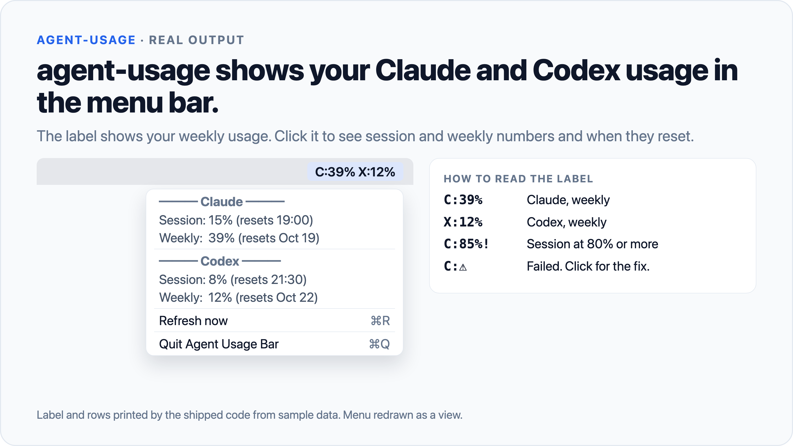
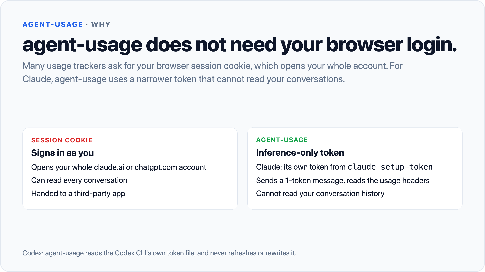
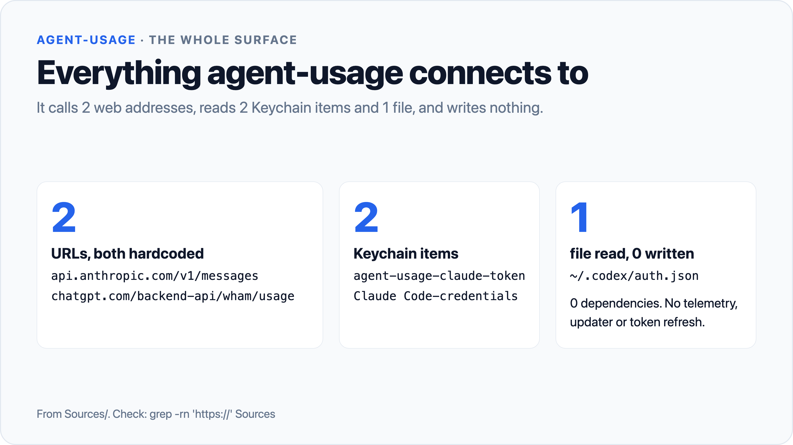

# agent-usage

agent-usage shows how much of your Claude and Codex limits you have used, in the Mac menu bar. It does not need your browser login.







```bash
git clone https://github.com/AaqifZ/agent-usage.git
cd agent-usage
./scripts/install.sh
```

## What it is

A small macOS tool with two faces:

- **Agent Usage Bar**, a menu bar app. The label reads `C:39% X:12%`. Click it for session (5-hour) and weekly usage per provider.
- **`agent-usage`**, a CLI for scripts, launchers and automation. It prints text or JSON.

It is about 1,270 lines of Swift, including its self-test, with zero dependencies. You can read all of it in one sitting.

## Why

Many usage trackers ask for your claude.ai or chatgpt.com session cookie. That cookie opens your whole account, including every conversation. You only want two percentages.

agent-usage uses narrower keys instead:

- **Claude:** its own inference-only token from `claude setup-token`. That token can send a message and read rate-limit headers. It cannot read your conversation history.
- **Codex:** the token the Codex CLI already keeps in `~/.codex/auth.json`. agent-usage only reads it. It never refreshes or rewrites it.

There is no updater, no telemetry and no background service other than the menu bar app. New code reaches your Mac only when you pull it.

## Install

You need macOS 13 or later and the Xcode Command Line Tools (`xcode-select --install`). Then run the 3 commands at the top of this page.

The installer:

1. Builds both binaries with `swift build -c release`.
2. Wraps the menu bar binary in `Agent Usage Bar.app` and signs it ad hoc.
3. Copies the CLI to the first writable folder of `/opt/homebrew/bin`, `/usr/local/bin`, `~/.local/bin` or `~/bin`. If none is writable, it creates `~/.local/bin`.
4. Copies the app to `/Applications` and adds it as a Login Item.
5. Opens the app.

If the CLI folder is not on your `PATH`, the installer prints a warning and the line to add to `~/.zshrc`.

To add the Login Item, the installer asks System Events through AppleScript. macOS may ask you to let Terminal control System Events. Click **OK**. If you decline, the app still works, but it does not start at login.

### Set up Claude (once)

1. Run `claude setup-token` and approve the sign-in in your browser.
2. Run `agent-usage --set-claude-token` and paste the token. The input stays hidden.
3. If the menu bar app shows a Keychain prompt, click **Always Allow**.

The CLI tests the token against the API before it saves it, so a bad paste never replaces a working token. To paste from the clipboard, run `pbpaste | agent-usage --set-claude-token`.

This token lasts about a year and nothing else uses it. Without it, agent-usage falls back to Claude Code's own Keychain token, which can expire within hours if you only use the Claude desktop app.

### Set up Codex

Sign in with the Codex CLI: `codex login`. Nothing else is needed.

Each provider is optional. If one has no credentials, agent-usage leaves it out.

## Use

### Menu bar

- `C:39% X:12%` shows weekly usage for Claude (C) and Codex (X).
- `C:85%!` means a session window is at 80% or more. The session number then takes over the label.
- `C:⚠` means a provider failed. Hover or click to read the error and the fix.

Click the label for a per-provider breakdown and a **Refresh now** item. The app refreshes every 60 seconds.

### CLI

```bash
agent-usage
# ━━━ Claude ━━━
# Session: 15% (resets 19:00)
# Weekly:  39% (resets Oct 19)
#
# ━━━ Codex ━━━
# Session:  8% (resets 21:30)
# Weekly:  12% (resets Oct 22)

agent-usage --provider claude    # Claude only
agent-usage --provider codex     # Codex only
agent-usage --json               # machine-readable
agent-usage --watch              # poll every 60s, print on change
```

Exit codes: 0 success, 1 credential error, 2 network or API error, 3 unexpected response format. If any selected provider fails, the exit code is non-zero.

### Uninstall

```bash
./scripts/uninstall.sh
```

This removes the CLI, the app, its Login Item and the `agent-usage-claude-token` Keychain item. agent-usage stores nothing else.

## How it works

### Claude

1. Reads its own token from the Keychain item `agent-usage-claude-token`.
2. If that item is absent, reads Claude Code's item `Claude Code-credentials`, and refuses it if it has expired.
3. Sends a 1-token message to `api.anthropic.com/v1/messages`.
4. Reads the usage percentages from the reply headers (`anthropic-ratelimit-unified-5h-*` and `-7d-*`).

### Codex

1. Reads `~/.codex/auth.json` (or `$CODEX_HOME/auth.json`). Refuses the file if anyone but you can read it (mode must be `0600` or tighter).
2. Sends a GET to `chatgpt.com/backend-api/wham/usage` with the access token.
3. Sorts each limit by its length: 24 hours or less is the session, longer is weekly. Team plans have only a weekly limit, so the session row is left out.

Neither path ever refreshes a token. A refresh would rotate the token under the official CLI and could sign it out. If a token expires, the label shows `⚠` and the error tells you which command to run.

### Attack surface

| Question | Answer |
|---|---|
| Session cookies used | None. |
| URLs it can reach | 2, both hardcoded: `api.anthropic.com/v1/messages`, `chatgpt.com/backend-api/wham/usage`. |
| Keychain items read | `agent-usage-claude-token` and `Claude Code-credentials`. |
| Keychain items written | `agent-usage-claude-token`, only by `--set-claude-token`, after an API check. Device-only, no iCloud sync. |
| Files read | `~/.codex/auth.json`, or `$CODEX_HOME/auth.json` if set. |
| Files written | None. |
| Tokens refreshed | None. |
| Updater, telemetry, subprocesses | None. |
| Signing | Ad hoc (`codesign --sign -`). No Apple Developer certificate needed. |

### Check it yourself

```bash
grep -rn 'https://' Sources                    # exactly 2 URLs
grep -rn 'Service = "' Sources                 # the 2 Keychain items
grep -rn 'auth.json\|CODEX_HOME' Sources       # the Codex token file only
find Sources -name '*.swift' | xargs wc -l     # about 1,270 lines
swift run AgentUsageSelfTest                   # 32 offline checks
```

If any of these surprise you, something is wrong.

## Limits

- **The Codex endpoint is undocumented.** `chatgpt.com/backend-api/wham/usage` is not a public API. OpenAI can change or remove it without notice. When that happens, the Codex row shows `⚠` until the parser is updated.
- **Each Claude refresh costs a little usage.** There is no usage endpoint for this token, so agent-usage sends a 1-token message (`max_tokens: 1`) and reads the reply headers. The menu bar app does this every 60 seconds. Those headers are not a documented API either, and can change.
- **Your Keychain may ask again after a reinstall.** The app is signed ad hoc, so each new build can look like a new app to the Keychain. Click **Always Allow** again.
- **macOS only.** It needs macOS 13 or later and builds from source.

## License

MIT. See [LICENSE](LICENSE).

Built with AI coding agents.
